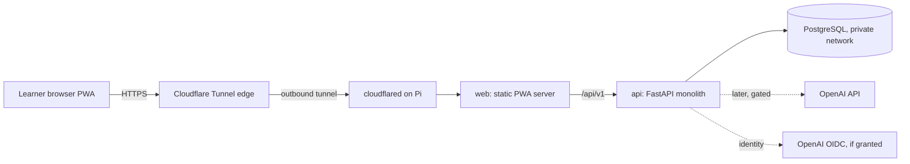
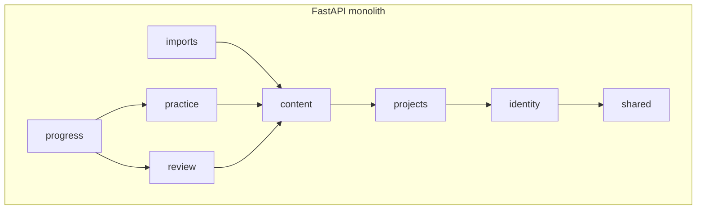
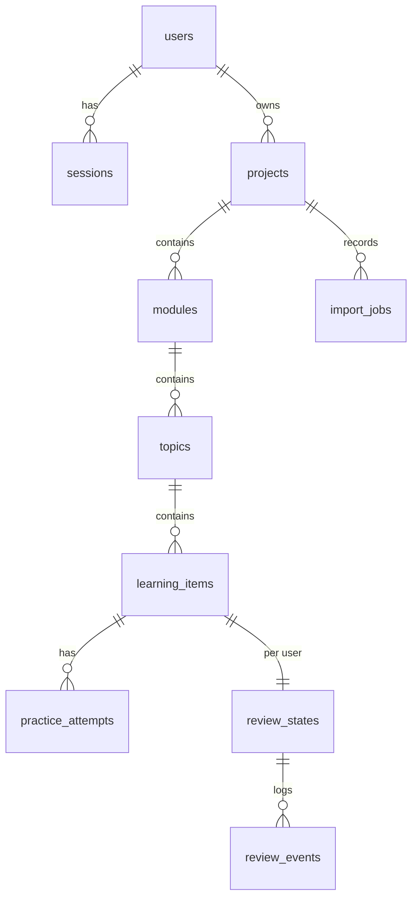

# Alvo Phase 0 Architecture

Status: PROPOSAL, awaiting owner approval. No application code exists.

## 1. Scope and priorities

MVP (priority order): (P0) secure foundation, auth/session, ownership isolation; (P1) Project/Module/Topic/Item CRUD; (P1) versioned JSON import (`ADD_NEW_ONLY`) and export; (P2) responsive PWA; (P2) practice modes `read_aloud`, `fill_gaps`, `keyword_speaking`, `free_speaking` with browser TTS/recording; (P2) FSRS review and dashboard.
Out of MVP: sharing, payments, native apps, offline sync, real-time voice AI, vector DB, paid AI calls (Phase 3).

Non-functional: security gate on every change; TDD; WCAG 2.2 AA as design target; single Raspberry Pi 5 budget (no extra services); p95 API latency target < 300 ms for non-AI endpoints (to be measured, not claimed).

## 2. Naming correction

The master prompt layout shows `src/ape_speak/`. Per section 0A the package is `alvo`. This plan uses `src/alvo/`.

## 3. Repository layout

```text
apps/
  api/
    src/alvo/{identity,projects,content,imports,practice,review,progress,shared}/
      # per module: api/ application/ domain/ infrastructure/ (create only when needed)
    tests/{unit,integration,authz,security}/
    alembic/
  web/                      # React + TS + Vite + Tailwind PWA
docs/{architecture,adr,security,api,decisions,ops}/
.github/workflows/{ci.yml,release.yml}
compose.yaml  compose.prod.yaml  .env.example
```

`packages/contracts` is NOT created; OpenAPI-generated TS types are enough (ADR-0003).

## 4. Module contracts

| Module | Owns | Exposes to others | Must not |
|---|---|---|---|
| identity | users, sessions, provider links | `current_principal` dependency, `UserId` | know about projects |
| projects | projects (single owner) | `ProjectAccess.require_owner(principal, project_id)` | write content tables |
| content | modules, topics, learning_items, versions | use cases `add_items`, `get_item` | decide ownership (asks projects) |
| imports | import_jobs, schema, dedupe | `preview`, `commit` calling content use cases | write content tables directly |
| practice | attempts, audio metadata | `record_attempt` | schedule reviews |
| review | review_states/events, FSRS adapter | `rate`, `due_queue` | read practice tables |
| progress | read models | dashboard queries | mutate anything |
| shared | config, db session, errors, security primitives, logging | - | hold business logic |

Rules: dependencies point toward domain; routes are thin; Pydantic DTOs are not ORM models; cross-module calls go through application-layer functions, never foreign-table writes. Enforced by `import-linter` contracts in CI (ADR-0004).

Patterns (each justified): Strategy for practice modes and import duplicate policy; Adapter for FSRS library, STT/TTS/LLM, identity provider; Ports only at real boundaries (identity, clock, speech/LLM later). No generic repositories or Unit of Work; the SQLAlchemy session is the transaction boundary.

## 5. Diagrams







Composite foreign keys carry `project_id` down the hierarchy (module, topic, item) so the database rejects parent-child mismatches. `user_id` is derived from the project owner, never from the client.

## 6. Technology choices (verify versions at Phase 1A)

Python 3.12+, FastAPI, Pydantic v2, SQLAlchemy 2.x, Alembic, PostgreSQL (current supported major), `uv` with hashed lockfile, ruff, mypy strict, pytest + pytest-asyncio, Testcontainers or CI service container for PostgreSQL, import-linter. Frontend: React, TypeScript, Vite, Tailwind, React Router, TanStack Query, Vitest + RTL, Playwright, `vite-plugin-pwa`. FSRS: evaluate the maintained `fsrs` PyPI package behind an adapter (ADR-0005; verify license, maintenance, ARM64 wheels). Dependency check plan: `pip-audit`, `npm audit`, Dependabot, lockfile review on every PR.

## 7. Session, CSRF, CORS design

Server-side opaque sessions in PostgreSQL (hash of a 256-bit random token stored, not the token). Cookie: `__Host-` prefix, `HttpOnly`, `Secure`, `SameSite=Lax`, Path=/. Idle 30 min sliding up to 12 h absolute (tunable). Rotate on login and privilege change; revoke on logout. CSRF: double-submit token bound to session plus `Origin` header check on unsafe methods. Web and API share one origin (static PWA and `/api/v1` behind one host), so CORS is disabled (no cross-origin allowed) rather than allowlisted. Trusted proxy handling: accept `X-Forwarded-*` only from the tunnel's network, enforce HTTPS scheme.
Rate limiting: PostgreSQL-backed counters (single instance, no Redis); correct for the one-Pi topology and documented as not horizontally scalable.

## 8. Import/merge invariants (JSON schema v1)

1. Preview performs zero writes. Commit is one transaction, idempotent via source digest + idempotency key.
2. Never import ids, ownership, review history or auth state.
3. Duplicate order: (a) `externalId` unique per project; (b) fingerprint = SHA-256 of NFKC-normalized, casefolded, whitespace-collapsed `type + prompt` within project; (c) similar-but-different content is flagged, never merged.
4. DB unique constraints on `(project_id, external_id)` and `(project_id, fingerprint)` back the in-memory checks; concurrent-import race tests required.
5. Caps: 1 MiB body, depth 8, 2000 items, field length limits, duplicate JSON keys rejected.
6. Existing items, customized answers, attempts and FSRS state are never modified by `ADD_NEW_ONLY`.

## 9. Rough API (`/api/v1`)

```text
GET  /auth/session            POST /auth/logout        GET /auth/csrf
GET/POST /projects            GET/PATCH/DELETE(archive) /projects/{id}
GET/POST /projects/{id}/modules | /topics | /items      (nested, ownership checked)
GET  /templates/import-v1.json   (+ JSON Schema)
POST /projects/{id}/imports/preview   POST /projects/{id}/imports/{job}/commit
GET  /projects/{id}/export
POST /items/{id}/attempts     GET /reviews/due     POST /reviews/{item}/rate
GET  /dashboard
GET  /health/live  GET /health/ready
```
Errors: RFC 9457 problem+json, correlation id, no internals. Pagination: cursor, max page size 100. Foreign-owner resources return 404.

## 10. Security baseline mapping

ASVS 5.0.0 Level 2 target, mapped per chapter during each slice (see `docs/security/review-checklist.md` in Phase 1A). Reference lists (ASVS 5.0.0, API Top 10 2023, NIST 800-63B-4) must be re-verified against current official pages in Phase 1A; not yet re-verified in this session. No certification is claimed.

## 11. Phased backlog (every subphase ends with a stop for approval)

| ID | Slice | First failing tests (TDD) | Risk |
|---|---|---|---|
| 1A-1 | Repo tooling: git init, ruff/mypy/pytest, pre-commit with Gitleaks, `.env.example`, settings validator | placeholder secrets rejected at startup; scanner flags fake key in fixture | low |
| 1A-2 | `ci.yml` (SHA-pinned actions, read-only perms, zizmor/actionlint, gitleaks, pip-audit, trivy) | workflow lint passes; PR from fork has no secrets | med |
| 1A-3 | PostgreSQL + Alembic + test DB; ARM64 image build + non-prod Compose smoke | `/health/ready` with and without DB; DB not published | med |
| 1B | IdentityProvider port, mock adapter (test only), sessions, CSRF, logout | fixation, rotation, CSRF negative, mock unreachable in prod | high |
| 1C | Projects/modules/topics/items CRUD | two-user matrix, parent-child mismatch, mass assignment | high |
| 1D | JSON schema, preview, ADD_NEW_ONLY commit, export | re-import yields zero new, race test, oversize/deep JSON | high |
| 1E | PWA shell, project dashboard | a11y, mobile breakpoints, XSS rendering | med |
| 1F | Production release subphase (Pi hardening, ingress, backups, `release.yml`) | separate explicit approval | high |
| 2A-2C | Reading/TTS/writing; speaking modes; FSRS review | see spec section 11 | med |
| 3 | Paid speech behind BudgetGuard | the 10 cost-security tests | high |
